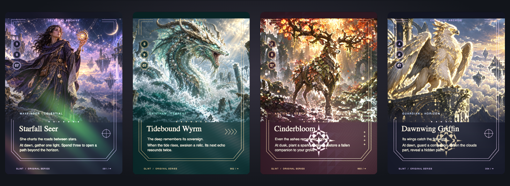

# card-glint

[](https://github.com/vishvananda/card-glint/actions/workflows/check.yml)
[](rust-toolchain.toml)
[](NOTICE.md)

A small, game-neutral card renderer. Rust/WASM manages caches, scene planning,
picking and pixel kernels. WebGL2 adds reusable etching, embossing and foil.
Your game supplies the artwork, frame geometry, typography and hit regions.

[](https://vishvananda.github.io/card-glint/)

[Try the interactive showcase](https://vishvananda.github.io/card-glint/) ·
[Architecture and layering](docs/architecture.md) ·
[Hardware and cache measurements](docs/performance.md)

**No internal art assets are used or distributed in this repository.** The
showcase illustrations, frames and symbols are original procedural designs.
Their [SVG sources](games/showcase/art) and [generator](scripts/generate-showcase-art.mjs)
are included under the repository's license. No external fonts or artwork are
loaded by the showcase. External game-art references are kept separately under
[references/magic](references/magic/README.md), with source links and attribution.

## What it does

- Five finishes: regular, etched, prismatic, cold foil and Opal embossing.
- Independent face, artwork-edge, mask, decoded-image and overlay caches.
- Explicit layers above/below foil, foil exclusion masks and etch contributions.
- One depth surface for each card and its foil, including overlapping cards.
- Instanced scenes, perspective-aware picking, context recovery and PNG export.
- Game packs that remain separate from both the renderer and application UI.

The browser still rasterizes fonts and static faces with Canvas2D. This is not a
complete Rust text-layout engine. The large-scene test uses 2,000 instances of
three faces; it does not claim that 2,000 unique high-resolution cards fit in
memory. See [limits and cache ownership](docs/architecture.md).

## Build and run

Node 22+, the pinned Rust toolchain, and wasm-bindgen-cli are required.

```sh
npm ci
rustup show
cargo install wasm-bindgen-cli --version 0.2.127 --locked
npm run build
npm run preview
```

Open <http://localhost:4283/card-glint/>. Everything the showcase loads is local.
Move over the cards to sweep the light; use **Inside the renderer** for metrics
and cache tests. `npm run art` regenerates the three SVG illustrations.

```sh
npm run check                  # rustfmt, strict Clippy, Rust tests, TS, formatting, boundaries
npx playwright install chromium
npm run test:browser           # preview server must be running
npm run test:showcase          # local-only asset check and README screenshot
npm run test:package           # independent packed-library consumer
```

CI runs these checks and uploads browser evidence. `npm run format` applies
rustfmt and Prettier. Native and WASM Clippy run with warnings denied; unsafe
Rust is forbidden.

The showcase is hosted on GitHub Pages. After checks pass on `main`, the same
workflow publishes `dist/lab`; pull requests only run checks. The README preview
links to the interactive page. All artwork and WASM are served from that site,
with no application server or external asset host required.

## Use it in an application

Build the library, run `npm pack`, then install that archive in your application.
The root export is game-neutral; the original showcase pack is optional.

```ts
import { createRenderer, IDENTITY } from 'card-glint';
import { showcase } from 'card-glint/showcase';
import wasmUrl from 'card-glint/renderer.wasm?url';

const renderer = await createRenderer({ canvas, wasmUrl });
renderer.upsertCards([
  {
    id: 1,
    revision: 1,
    recipe: showcase.describe(
      {
        name: 'Astral Compass',
        subtitle: 'Instrument',
        theme: 'orbit',
        charge: 3,
        serial: '001',
        illustration: '/art/orbit.svg',
        rules: 'Chart a path through the unknown.',
      },
      'inspect',
    ),
  },
]);
await renderer.ready(1, 1);
// Local unit quad → clip space; this example assumes a 720 × 1000 canvas.
renderer.updateScene([
  {
    id: 1,
    card: 1,
    finish: 'etched',
    transform: [2, 0, 0, 0, 0, -2, 0, 0, 0, 0, 1, 0, -1, 1, 0, 1],
  },
]);
renderer.render({ viewProjection: IDENTITY, pointer: [0.5, 0.5] });
// On unmount:
renderer.dispose();
```

Copy the chosen SVG into your application's public asset directory. Serve WASM
as `application/wasm`. The host owns canvas sizing, transforms, animation,
accessibility and editor controls. Use native aspect ratios when mapping card
quads to screen pixels; [the lab layout](examples/lab/layout.ts) shows how.

Implement `GamePack<T>` to adapt another game's presentation data. A pack returns
immutable `FaceRecipe` rasters, artwork placement, masks and semantic hit regions.
See [the original example pack](games/showcase/src/index.ts). Applications can
consume the renderer without a frontend framework or a game-engine checkout.

## Sources and fan-content notice

External reference metadata links to
[wingedsheep/mtg-card-renderer](https://github.com/wingedsheep/mtg-card-renderer),
[Investigamer/cardconjurer](https://github.com/Investigamer/cardconjurer), and
[Andrew Gioia's Keyrune](https://github.com/andrewgioia/keyrune).
Their assets retain their own rights and licenses and are **not bundled** with
this renderer or used in the README images. See [NOTICE.md](NOTICE.md).

card-glint is unofficial Fan Content permitted under the
[Fan Content Policy](https://company.wizards.com/en/legal/fancontentpolicy).
Not approved/endorsed by Wizards. Portions of the materials referenced are
property of Wizards of the Coast. ©Wizards of the Coast LLC.
