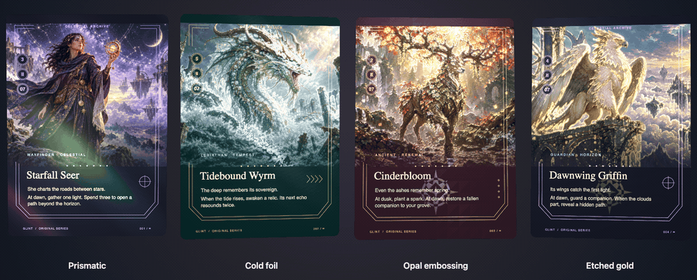
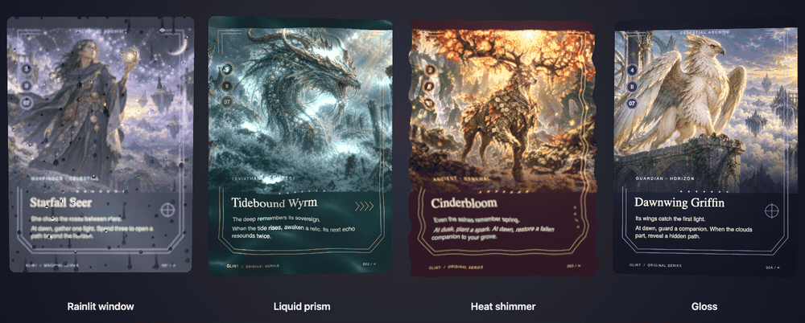

# card-glint

[](https://github.com/vishvananda/card-glint/actions/workflows/check.yml)
[](https://github.com/vishvananda/card-glint/releases/latest)
[](rust-toolchain.toml)
[](NOTICE.md)

A small, game-neutral card renderer. Rust/WASM manages caches, scene planning,
picking and pixel kernels. WebGL2 adds reusable etching, embossing and foil.
Your game supplies the artwork, frame geometry, typography and hit regions.

[](https://vishvananda.github.io/card-glint/)

**Four foils:** prismatic · cold foil · Opal embossing · etched gold.
[Watch / download MP4](https://vishvananda.github.io/card-glint/media/showcase-foils.mp4) ·
[Static preview](docs/images/showcase.png)

[](https://vishvananda.github.io/card-glint/?finish=surfaces)

**Living surfaces + gloss:** rain · pool water · heat shimmer · gloss.
[Watch / download MP4](https://vishvananda.github.io/card-glint/media/showcase-living.mp4) ·
[Static preview](docs/images/showcase-living.png)

[Try the interactive showcase](https://vishvananda.github.io/card-glint/) ·
[Architecture and layering](docs/architecture.md) ·
[Hardware and cache measurements](docs/performance.md)

**No internal art assets are used or distributed in this repository.** The
showcase uses original AI-generated fantasy illustrations and code-drawn frames
and symbols. The [artwork, prompts and provenance](games/showcase/art/README.md)
are included under the repository's license, alongside small procedural SVG
alternatives and their [generator](scripts/generate-showcase-art.mjs).
No external fonts or artwork are loaded by the showcase. The optional
[Magic drawing pack](games/magic/README.md) contains frame definitions, external
asset references, its fan-content notice, and a guide for contributing fixes.

## What it does

- Ten finishes: regular, gloss, etched, prismatic, cold foil, reflective holofoil, Opal embossing,
  raindrops on glass, heat shimmer and pool water with caustics.
- Independent face, artwork-edge, mask, decoded-image and overlay caches.
- Explicit layers above/below foil, foil exclusion masks and etch contributions.
- One depth surface for each card and its foil, including overlapping cards.
- Instanced scenes, perspective-aware picking, context recovery and PNG export.
- Game packs that remain separate from both the renderer and application UI.

Finishes default to pointer-based lighting, including the compatibility gloss
from 0.5.3. Opt into a fixed virtual studio with `Frame.lighting: 'studio'` and
supply each card's world-space `Instance.normal` from its visible pose. That mode
ignores pointer position for lighting while retaining card-local water interactions.
`normalLightingVersion === 1` detects support. Pass the same `lighting` and
`normal` to `exportCard` for matching PNGs. See the
[normal-lighting experiment](docs/experiments/normal-lighting.md) for scope and checks.

The browser still rasterizes fonts and static faces with Canvas2D. This is not a
complete Rust text-layout engine. The large-scene test uses 2,000 instances of
three faces; it does not claim that 2,000 unique high-resolution cards fit in
memory. See [limits and cache ownership](docs/architecture.md).

## Build and run

Node 22+, the pinned Rust toolchain, and wasm-bindgen-cli are required.

```sh
npm ci
rustup show
cargo install wasm-bindgen-cli --version 0.2.127 --locked
npm run build
npm run preview
```

Open <http://localhost:4283/card-glint/>. Everything the showcase loads is local.
The collection opens with four foil finishes. Choose **Living surfaces + gloss**
in the **Finish** selector to compare the other four treatments on the same cards.
Hover or drag on a card to tilt it and disturb its water; neighboring cards keep
their independent idle motion and reflections. On touchscreens,
swipe beside or between cards to scroll the page. They drift gently when
unattended; **Pause motion** freezes animation. Reduced-motion preferences are
respected. **Effect: Full card / Artwork only** switches coverage for every
treatment; saved PNGs use the same setting. Use **Inside the renderer** for metrics
and cache tests. `npm run art` regenerates the optional SVG alternatives; it does
not overwrite the generated fantasy illustrations.

The **Wear** selector adds Fresh, Lightly played, Well played or Heavily played
abrasion over any finish. Open `?finish=gloss&wear=heavy` for worn gloss, or
`?wear=heavy` for worn foils. Chipped paper edges, corner abrasion and fine
shuffle scratches remain fixed as the card tilts. Intact areas retain the
selected finish; shallow ink loss on foils exposes reflective film, while deep
chips expose matte cardstock. Full card includes edge wear; Artwork only keeps
the frame protected.

Set `Instance.wear` to `{ amount: 0.6, seed: 42 }`: amount ranges from 0 (fresh)
to 1 (heavily played), and the optional uint32 seed defaults to the instance ID.
Persist that seed with the card to keep its wear when scene identity changes.
Pass the same `wear` and `instanceId` to `exportCard` for matching PNGs.

```sh
npm run check                  # rustfmt, strict Clippy, Rust tests, TS, formatting, boundaries
npx playwright install chromium
npm run test:browser           # preview server must be running
npm run test:showcase          # local-only asset check and README screenshot
npm run test:surfaces          # animation, local ripples/slosh, masks and cache reuse
npm run test:touch             # native touch gestures, tilt and page scrolling
npm run test:hover-isolation   # pointer affects one card; neighbors retain idle reflections
npm run test:coverage          # artwork-only/full-card masks, exports and cache reuse
npm run test:worn              # wear levels, foil layering, seeds, exports and cache reuse
npm run test:optics            # caustic motion measured across successive frames
npm run test:deformation       # animated silhouette, Rust picking, overlap and export
npm run test:parallax          # recessed ink, floor illumination and shared light-map reuse
npm run test:package           # independent packed-library consumer
```

CI runs these checks and uploads browser evidence. `npm run format` applies
rustfmt and Prettier. Native and WASM Clippy run with warnings denied; unsafe
Rust is forbidden.

The showcase is hosted on GitHub Pages. After checks pass on `main`, the same
workflow publishes `dist/lab`; pull requests only run checks. The README preview
links to the interactive page. All artwork and WASM are served from that site,
with no application server or external asset host required.
The README's paired eight-second GIFs and MP4s are captured from the same renderer;
[media reproduction instructions](docs/images/README.md) include the capture script.

## Use it in an application

[Download a release](https://github.com/vishvananda/card-glint/releases/latest), or
install the prebuilt package directly:

```sh
npm install https://github.com/vishvananda/card-glint/releases/download/v0.7.0/card-glint-0.7.0.tgz
```

The package includes JavaScript, WASM and TypeScript declarations; no Rust build
is needed to consume it. The root export is game-neutral; the original showcase
pack is optional. For a plain HTML page, download the browser ZIP, extract it,
serve the directory over HTTP and open `index.html`. It includes a working example
with local artwork. Keep the WASM and its matching JavaScript files together.
Release checksums and source/toolchain metadata accompany both archives.

To package a source checkout yourself, build it and run `npm run package:release`.
CI tests the extracted browser ZIP as well as an independent npm consumer; pushing
a matching `vX.Y.Z` tag publishes those checked artifacts to GitHub Releases.

For direct inclusion in an HTML page, use the version-pinned **jsDelivr** build:

```html
<script type="module">
  import {
    createRenderer,
    IDENTITY,
  } from 'https://cdn.jsdelivr.net/gh/vishvananda/card-glint@cdn-v0.7.0/browser.js';

  const renderer = await createRenderer({ canvas: document.querySelector('canvas') });
  // Supply your own game pack/card recipes, then render as below.
</script>
```

The default WASM URL resolves beside its JavaScript wrapper on the CDN. The
optional example pack is `showcase.js`, and its illustrations live under `art/`
at the same versioned base URL. [Open the working CDN example](https://vishvananda.github.io/card-glint/cdn/)
or copy [its single HTML file](examples/cdn/index.html). There is no npm account,
bundler or Rust toolchain requirement for consumers.

CI publishes a separate, immutable `cdn-vX.Y.Z` artifact tree from the checked
browser ZIP. Source tags and the source branch stay free of generated bundles.
Always pin the exact CDN tag; keep the JS chunks and WASM from the same build.
See [jsDelivr's GitHub delivery and caching documentation](https://github.com/jsdelivr/jsdelivr#github).

```ts
import { createRenderer, IDENTITY } from 'card-glint';
import { showcase } from 'card-glint/showcase';
import wasmUrl from 'card-glint/renderer.wasm?url';

const renderer = await createRenderer({ canvas, wasmUrl });
renderer.upsertCards([
  {
    id: 1,
    revision: 1,
    recipe: showcase.describe(
      {
        name: 'Starfall Seer',
        subtitle: 'Wayfinder',
        theme: 'orbit',
        charge: 3,
        serial: '001',
        illustration: '/art/orbit.webp',
        rules: 'She charts the roads between stars.',
      },
      'inspect',
    ),
  },
]);
await renderer.ready(1, 1);
// Local unit quad → clip space; this example assumes a 720 × 1000 canvas.
renderer.updateScene([
  {
    id: 1,
    card: 1,
    finish: 'etched',
    transform: [2, 0, 0, 0, 0, -2, 0, 0, 0, 0, 1, 0, -1, 1, 0, 1],
  },
]);
renderer.render({ viewProjection: IDENTITY, pointer: [0.5, 0.5] });
// On unmount:
renderer.dispose();
```

Copy the chosen illustration into your application's public asset directory. Serve WASM
as `application/wasm`. The host owns canvas sizing, transforms, animation,
accessibility and editor controls. Use native aspect ratios when mapping card
quads to screen pixels; [the lab layout](examples/lab/layout.ts) shows how.

Implement `GamePack<T>` to adapt another game's presentation data. A pack returns
immutable `FaceRecipe` rasters, artwork placement, masks and semantic hit regions.
See [the original example pack](games/showcase/src/index.ts). Applications can
consume the renderer without a frontend framework or a game-engine checkout.

## Animated surfaces and interaction

Set an instance's `finish` to `rain`, `heat` or `pool`, and pass elapsed **seconds**
as `Frame.time`. An omitted or fixed time gives a still image. Feed the actual
result of `renderer.hitTest(x, y)` into `Frame.hover` for card-local ripples:

```ts
renderer.render({
  viewProjection: IDENTITY,
  time: elapsedSeconds,
  hover: hit ? { instance: hit.instance, uv: hit.uv } : undefined,
});
```

Update each instance's transform and surface normal together when it tilts.
The renderer derives damped slosh from changes in the transform and normal.
The [showcase motion controller](examples/lab/motion.ts) demonstrates perspective
tilt, a smooth pointer handoff and the idle orbit. Pointer coordinates for
`Frame.hover` use the top-left card origin; `Frame.pointer` remains the normalized
canvas-space foil-light control.

`Instance.rainFog` optionally changes rain condensation density from 0 (clear)
to 2. Omit it or use 1 for the unchanged default. Droplets, their refraction,
reflections, blur and motion retain their native settings. Pass the same value
to `exportCard` for a matching image. The root export `rainFogVersion === 1`
lets a host detect this option without assuming a release number. Changes reuse
prepared textures and add one float per instance, with no extra rendering pass.

These are procedural optical treatments, not a fluid solver. Heat refracts the
printed face in horizontal bands with slight blur. Rain adds small lenses and
draining drops over lightly fogged glass. Rain counter-projects the image around the card center, so the scene stays
approximately in place behind the turning window. Pool keeps the artwork painted
on the card’s floor while damped water modes lag, rebound and settle. It projects refracted light
onto a separate floor map: concentrated rays brighten it and diverging rays dim
it. Surface waves, reflections and pointer ripples sit above that lit floor.
Under-finish content participates; over-finish content stays clear of these
optical distortions. Existing finish exclusion masks apply.

For a heat-warped **outline**, set `deformation: { kind: 'heat', amount: 0.012 }`
on the instance (maximum `0.02` of card width). Rounded clipping, card layers,
masks and Rust picking follow the same inverse warp. World/scene/HUD layers
keep their own transforms. The showcase enables this only for Full card heat;
Artwork only keeps the frame fixed. Leave `deformation` unset for the original
fixed silhouette with any finish.

Animation reuses card textures and masks. Pool adds one shared light-map pass
when time changes, regardless of card count; fixed-time renders reuse it.
See [surface costs and limits](docs/architecture.md#animated-optical-surfaces)
and [optical treatment notes](docs/optical-surfaces.md).
`exportCard(..., { time, deformation, instanceId })` captures a still using the
chosen outline and surface seed. Warped exports fit the whole envelope into the
requested dimensions, preserving aspect ratio with transparent margins. Export
does not replay live ripple/slosh history or disturb the live motion state.

## Contributing game packs

Frame fixes and new card layouts are welcome. The [Magic pack guide](games/magic/README.md)
maps asset selection, geometry, text layout, and composition to their source files.
Use `card-glint/magic` and `card-glint/magic/fonts.css` to consume that pack;
the core import remains independent of it. [Sources and notices](NOTICE.md)
describe the separation between repository code and external game assets.

### Optional cardstock coating

Set `Instance.cardstock` to `{ amount: 0.2 }` for subtle, irregular relief in the
clear coating over any optical finish. The amount ranges from 0 to 1. It modulates reflected light;
printing remains sharp. Relief varies the finish response locally without lowering its overall gain.
Gloss reflection is 10% stronger in 0.6.11, with or without relief. Cardstock relief is 10% softer at the same amount.
Omitted or zero keeps the smooth coating,
and regular printing ignores it. Pass the same `cardstock` option to `exportCard`
for matching PNGs. Wear is applied above the coating, so exposed paper stays matte.

A fixed relief map is generated once per renderer context on first use, shared
by all textured instances, and mip filtered when cards shrink. Tilt only samples
the map; it does not generate noise, upload pixels, or render a reference face.
The map adds approximately 4 MB per active context, reported in `surfaceBytes`,
and its one-time generation increments `surfacePasses`. Context restoration
rebuilds the map on first use. `npm run test:cardstock` checks rendering, validation,
export parity, cache reuse, filtering and context restoration.

### Experimental printed dots

`Instance.printDots = {}` adds rotated CMYK screens to
printing before finish and wear. Amount is 0..1 (default 0.35); period is 2..16 reference
pixels at 732px card width (default 2), independent of raster tier. Variation ranges from 0 (ideal screen) to 1 (more uneven),
defaulting to 0.5. Translucent CMYK impressions leave small light gaps. Stable plate offsets, ink spread and irregular edges
break up the ideal grid. Global pattern softness varies across fixed random patches, capped at 0.5 reference pixels; it does not blur the source lettering. Omitting the profile or setting amount to zero retains previous pixels. Pass the same option
to `exportCard`. The effect is optional on every finish. It uses screen derivatives to fade fine dots when a card
shrinks, reducing aliasing. Larger periods make the pattern easier to inspect.

This is an RGB-to-CMYK visual approximation, not a calibrated press profile.
An optional `inset` (0..0.2, in card-width units) excludes an outer rim from
the print effect; the default is 0.035. Set `inset: 0` for full-bleed printing. Game packs/hosts can supply their own rim.
For scanned illustrations, use `printDots: { artwork: false }`: dots still
apply to the frame and lettering outside the recipe's `artWindows`. Generated
illustrations can use `{}` (artwork included). Full-card scans should omit the
profile entirely. `DEFAULT_PRINT_DOTS`, exported from both the root and finish
entry, exposes the defaults for editors. Explicit settings continue to work.
The period scales with card width, so 244, 488 and 732px faces share a physical screen frequency. The conventional screen angles follow
[Adobe's prepress reference](https://helpx.adobe.com/indesign/desktop/print/ink-and-color-management/specify-halftone-frequency-and-resolution.html).

Printing with matching instance settings is prepared once into a context-owned,
mip-filtered sRGB texture cache (up to 16 MiB, shared across face revisions and
over-finish printing). Tilt and export reuse it without re-evaluating the screens.
Changing a setting/face may add a preparation pass; `surfacePasses` and
`surfaceBytes` include it. Mixed settings on a material group or oversized faces
keep the per-instance procedural path. The cache is released on disposal and
rebuilt after context loss. There are no per-frame CPU readbacks or texture uploads.

Host-owned renderers can reuse the same print-dot preparation, cardstock relief
map and selective finish coverage through `card-glint/finish`. `FinishTextures(gl)`
prepares GPU textures directly in a host-owned WebGL2 context, including sources
in texture-array layers, without CPU readback or a second context. See the
[host material contracts](docs/host-integration.md#printing-and-coating-in-host-materials)
for texture encoding, shader inputs, caching and ownership.
